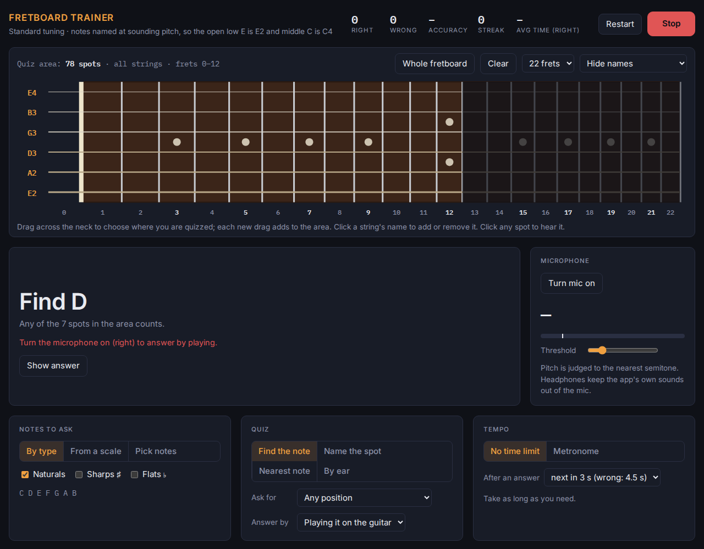

# Fretboard Trainer

A browser quiz for learning the notes on the guitar fretboard. It asks you to find a note, name a spot, find the nearest note from where you are, or find a note by ear, and you answer by playing your guitar into the microphone or by clicking on the neck.

**Open the app:** https://bruno.nicenboim.me/fretboard-trainer/

## How to use it

Press "Turn mic on", then Start, and play the answer on your guitar. Drag across the neck to choose where you are quizzed, and use the cards below it to choose the notes, the quiz, and the tempo. If you prefer the mouse, set "Answer by" to clicking.

Use Chrome or Firefox. Headphones keep the app's own sounds out of the microphone.

## Privacy

The microphone sound is analyzed in your browser and is never recorded or uploaded. Your settings and the session CSV stay in your browser. The site counts page visits with GoatCounter, which sets no cookies and collects no personal data. The page makes two outside requests: its fonts from Google Fonts and the visit counter.

## Running it locally

There is no build step and there are no dependencies.

- Open `index.html` in Chrome or Firefox, or
- in VS Code, install the recommended **Live Server** extension, right-click `index.html` and choose "Open with Live Server".

The microphone works from `file://` and from `localhost`. On any other address the page must be served over HTTPS.

## Files

| File | What it holds |
| --- | --- |
| `index.html` | Page structure: header, fretboard, question card, microphone card, settings, help |
| `css/styles.css` | All styling. Colours are tokens at the top, with a dark theme |
| `js/app.js` | All behaviour, in sections marked by `/* ---------- name ---------- */` comments |

## Sections of `js/app.js`

- **music data**: tuning, note spelling, scales
- **settings**: defaults, saved in `localStorage` under `fretTrainer.v3`; the quiz area is the set `SEL` of `string-fret` keys
- **fretboard drawing**: the SVG neck, dimmed cells, note markers
- **audio**: plucked-string synth and metronome click
- **quiz state**: the four quizzes (`mkFind`, `mkName`, `mkNear`, `mkEar`), answer handling, `finish()`, session log
- **metronome**: beat scheduler and the count-in / question / reveal phases
- **microphone & pitch detection**: YIN detector (`yin`), onset and octave guards (`micTick`)
- **controls**: wiring of the settings, drag selection, keyboard shortcuts, CSV export

## Known limits

- Pitch detection has not been tuned against a wide range of guitars; the Threshold slider is the first thing to adjust.
- The mic cannot tell the same pitch apart on two strings.

## About

This app was vibe coded with Claude. Changes are listed in [CHANGELOG.md](CHANGELOG.md). The code is under the [MIT license](LICENSE).
